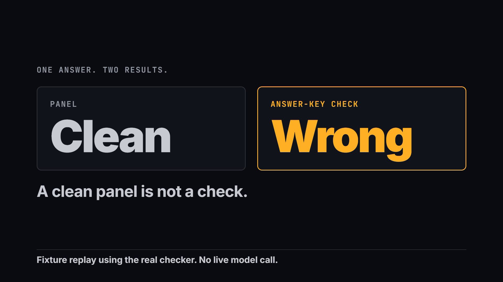
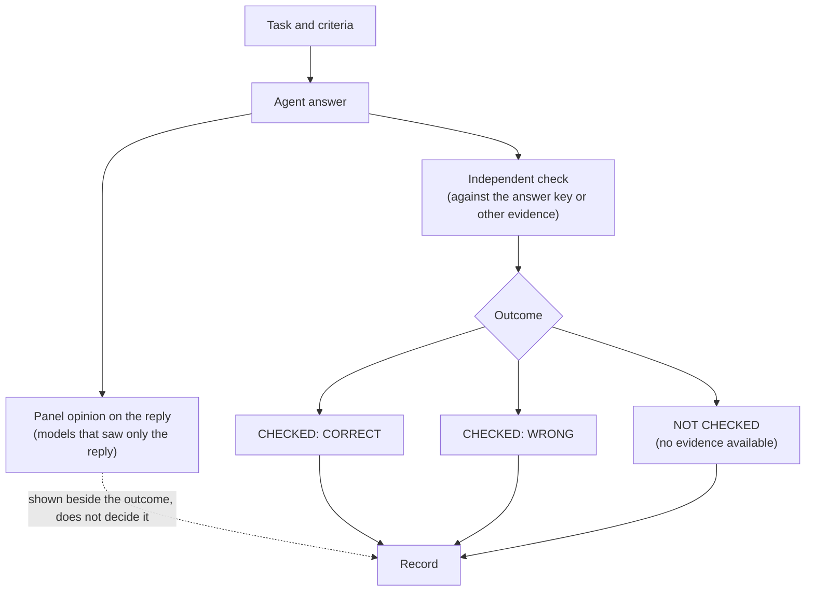
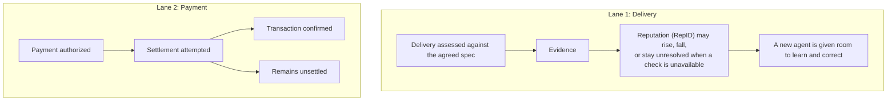

# Start here

TrustShell by AIDeaGuy

**Bring your AI. See what it checked. Keep the evidence behind the work.**

In two minutes you can run one published command against a public GitHub Actions run and get a card that marks each claim SUPPORTED, CONTRADICTED or NOT_CHECKED, with the evidence for each and a list of what the card does not prove. It needs Node 22 and a network connection, and nothing else: no account, no API key, and nothing of yours is uploaded. If you have longer, the steps below go from a page with no install to a demo that needs a full dependency install.

This page was written and checked on 2026-11-20. Every command on it was run that day, or its file was confirmed on the `main` branch that day. Commands and results drift; if one differs for you, [open an issue](https://github.com/DealAppSeo/trustshell/issues/new/choose).

## Explainer video



Video link: not published yet (placeholder: `EXPLAINER_VIDEO_URL`). The link will replace this line. The image above is the first frame of the video.

## Try it, in order of effort

**(a) No install: the start page.** <https://www.trustshell.dev/start> (being added in a separate PR; if this link is not live yet, use b).

**(b) One command: Inspect.** Inspect is the name of the feature; the command is `check`. Make an empty folder, and in it create a file named `claims.txt` containing exactly this line:

```
The check workflow succeeded on commit d9911681e9a2, run 44544121933.
```

Then run:

```
npx @hyperdag/trustshell@1.9.3 check https://github.com/DealAppSeo/trustshell/actions/runs/44544121933 --claims-file claims.txt
```

Expected: exit code 0 and the line `### Claims: 3 supported · 0 contradicted · 0 not checked` (run on 2026-11-20). The first run downloads the package and can take a minute or two. In Windows PowerShell, if `npx` is refused because running scripts is disabled, type `npx.cmd` instead. The one sentence holds three claims, each checked by itself: the workflow succeeded, the commit, and the run id. Change the commit in `claims.txt` to see a claim come back CONTRADICTED.

This step compares a sentence with GitHub's own record of a run. It does not use HAL, and its words are SUPPORTED, CONTRADICTED and NOT_CHECKED. Steps (c) and (d) and the first diagram are about HAL, whose outcomes are CHECKED: CORRECT, CHECKED: WRONG and NOT CHECKED. In both, not checked is never a pass.

**(c) No package install, needs git, Node and a clone: the backend conformance check.** In a clone of [DealAppSeo/repid-engine](https://github.com/DealAppSeo/repid-engine):

```
node scripts/trust-backend-conformance.mjs
```

It follows one agent through the engine's public API with no key and checks that the answers agree with each other. Expected last line, about: `9 verified, 0 failed, 7 not checked` (that exact line on 2026-11-20). The not-checked legs say what they would need; none of them is a pass.

**(d) Full install: the three-case demo.** In the same clone of repid-engine:

```
npm ci --legacy-peer-deps
```

```
npx ts-node --transpile-only scripts/demo/checked-answer-demo.ts
```

The install took fresh readers 24 to 40 minutes. The demo replays three made-up cases with no model call and prints, for each, the panel opinion, the independent check, and the outcome. The first diagram below is this demo. If you would rather not install, the full output is in [docs/CHECKED_ANSWER_DEMO.md](https://github.com/DealAppSeo/repid-engine/blob/main/docs/CHECKED_ANSWER_DEMO.md).

**(e) Wrap an agent we did not write.** [`examples/external-agent`](https://github.com/DealAppSeo/trustshell/tree/main/examples/external-agent) in this repository puts the published package around someone else's agent and runs on your machine only. Its README has the commands, and shows the option that turns blocking on (`blockAtOrAbove`); without it, nothing is blocked.

**Next step after any of these:** run (b) on a run from your own public repository, with your own agent's words in `claims.txt`. The recipe is at the top of the [README](https://github.com/DealAppSeo/trustshell#check-your-own-ci-run). If a claim comes back SUPPORTED and should not have, [tell us](https://github.com/DealAppSeo/trustshell/issues/new?template=wrong-verdict.yml).

## How HAL checks an answer

HAL is the Hallucination Assessment Layer: the part that compares what an agent said with evidence.



The outcome comes from the independent check alone. The panel opinion is written into the record next to it. A panel can call a reply clean while the answer is wrong, because the panel was shown the reply and not the task or the answer key. NOT CHECKED is not a pass.

## What changes after a job



A payment failure is not a delivery failure; each needs its own evidence.

Note: this diagram shows the intended rule and the words the receipt (the record kept for one job) uses. It is not all shipped behaviour. Today reputation also changes when a contract is marked fulfilled, before settlement. That is under review (true as of 2026-11-20).

## What it does not do yet

- Reputation ("RepID") is a score, not a token, and is not on-chain or portable for new agents in this release.
- The website creates a new test agent and does not attach to one you already run.
- Everything on-chain is on a test network (Base Sepolia).
- A proof shows a threshold statement and is not bound to an agent.
- By default it observes and blocks nothing.
- A model panel sees only the reply, which is why an independent check matters.

## Which repository is which

| Repository | Open it for | Maturity | Checked |
|---|---|---|---|
| [trustshell](https://github.com/DealAppSeo/trustshell) | The command-line tool and SDK, `@hyperdag/trustshell` on npm, and the trustshell.dev site. Steps (a), (b) and (e). | published package | 2026-11-20 |
| [repid-engine](https://github.com/DealAppSeo/repid-engine) | The reputation engine and its public API. Steps (c) and (d). | preview | 2026-11-20 |
| [hyperdag-protocol](https://github.com/DealAppSeo/hyperdag-protocol) | The builder's map of how the repositories fit, and the registry contracts they build on. Nothing installs from it. | preview | 2026-11-20 |
| [trustrepid](https://github.com/DealAppSeo/trustrepid) | The web front end for trustrepid.dev, which displays scores read from the engine's public API. | preview | 2026-11-20 |
| [trinity-symphony-shared](https://github.com/DealAppSeo/trinity-symphony-shared) | The runtime for the project's own group of agents. | experimental | 2026-11-20 |
| [example-agent](https://github.com/DealAppSeo/example-agent) | An older small agent that calls TrustShell. Its README pins an old version; prefer step (e). | experimental | 2026-11-20 |

Maturity labels: *published package* means a versioned release is on npm. *preview* means it runs and is public, on a test network or as a demo, and can change without notice. *experimental* means it is working code with no promise that it runs for you.

This list was checked on 2026-11-20; `gh repo list DealAppSeo --visibility public` shows the current set.

This is the only list of repositories kept in this project. It lives in this one file on purpose, because copies of such lists go out of date without anyone noticing.
