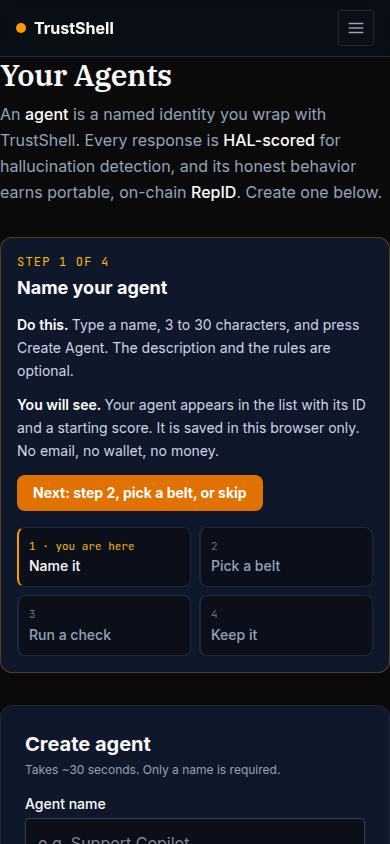
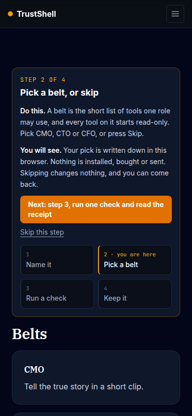
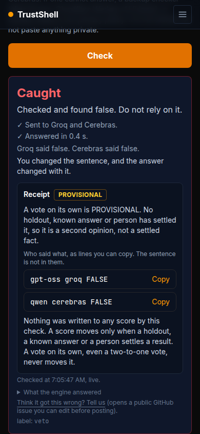
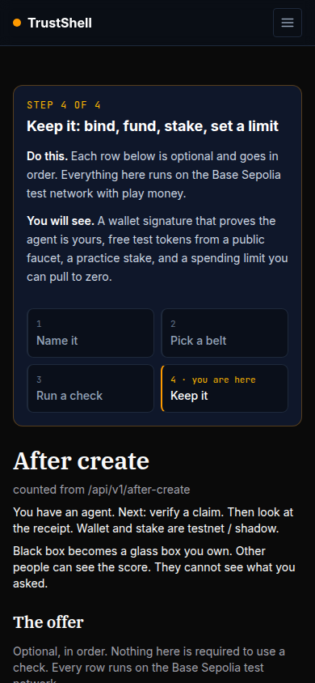
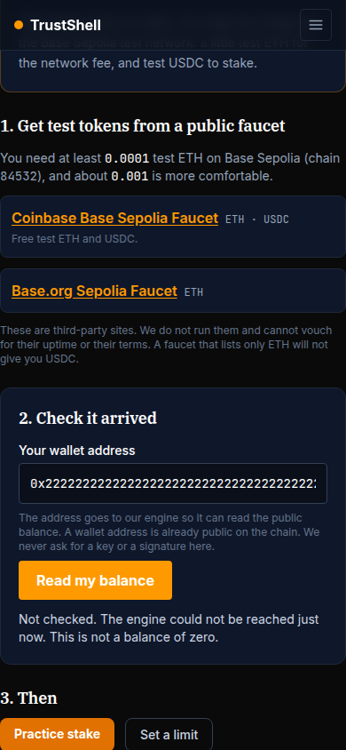

# Phone width

Run 2026-10-12 from a cloud sandbox. Branch `claude/bold-turing-icz50x-stranger-path` (PR #518).
Outcomes are VERIFIED / NOT_CHECKED / FAILED. Every block below is pasted from a real run; each says which engine it talked to.

The four screens, then the faucet, the practice stake and the passport, in Chromium at **390 x 844** (a phone), and again at **1280 x 900**. STUB engine. Same walk, same checks, both widths: 62 checks at each width, plus 16 that run once.

Nothing scrolled sideways on any screen at either width, and the tutorial card fit inside the screen on all four.

## The pictures (390px, first screenful of each)

| 1. Name it | 2. Pick a belt, or skip |
|---|---|
|  |  |

| 3. Run one check, read the receipt | 4. The offer |
|---|---|
|  |  |

| The faucet |
|---|
|  |

## Every check that passed at 390px

```
screen 1 prints "Step 1 of 4" ON the create page
screen 1 says what to do and what you will see
the rail names all four screens
the rail fits the screen and nothing scrolls sideways
naming an agent registers it and it appears
the register call carried the name
the rail's Next goes to screen 2
screen 2 offers Skip
no belt is picked until you pick one
picking a belt writes it down and says it installs nothing
the pick is remembered after a reload
suggest-a-skill refuses javascript: and stores nothing
suggest-a-skill refuses plain http
suggest-a-skill stores the link and says nothing was opened or installed
the stored link is still there after a reload
the saved link is plain text, not an anchor to click
the browser asked for NOTHING outside our app and engine (the link was not fetched)
screen 2 fits and nothing scrolls sideways
Skip on screen 2 lands on screen 3
screen 3 says a vote alone is PROVISIONAL, before you check
your agent is shown as TWO fields: score and ID
the new agent's score reads 200 and its ID reads "None yet" (off-chain only)
nothing was sent when the page loaded (no classify)
a true claim gets a receipt
the receipt says PROVISIONAL, never SETTLED
the receipt has who-said-what lines and no sentence in them
the receipt says nothing was written to any score
on the wire, the check asked two checkers and wrote NO score (only classify + passport reads) — POST /api/v1/classify, GET /api/v1/passport/5e7a1c3b-2d4f-4b6a-9c8e-1f0a2b3c4d5e
the score is unchanged by the check, and the page says so
a false claim is Caught, and also only PROVISIONAL
an equation is decided by exact calculation, with no vote lines
a split vote is NOT CHECKED and a no for spending and posting
a check the service could not finish is NOT CHECKED, never Checks out
if the score changed from somewhere else, the page says the check did not write it
the whole check session sent no score-event, stake or deposit
screen 3 fits and nothing scrolls sideways
screen 4 prints "Step 4 of 4" and has no Next after it
the offer lists register, bind, test tokens, practice stake and the limit, in order
the on-chain mint is said to be NOT offered yet, and has no button
the stake row is labelled practice and shadow, never live
the offer's buttons go to /bind, /faucet, /stake, /spend — ["/bind","/faucet","/stake","/spend"]
screen 4 fits and nothing scrolls sideways
the faucet page says we do not hand out tokens
it lists the engine's PUBLIC faucets, with ETH and USDC named
a hostile (javascript:) faucet link from the engine is dropped
faucet links are https and open in a new tab safely
no balance is read until you ask
a bad address is Not checked and sends nothing
an empty wallet reads 0 ETH and says not enough yet
after the faucet, the balance reads back and says enough to stake
an unreachable engine is Not checked and shows NO balance (not zero)
the faucet page only ever GOT: no POST, nothing dispensed
the faucet page fits and nothing scrolls sideways
/stake points at the faucet in plain view and is labelled practice
an UNBOUND agent cannot stake: the button is held and says to bind first
an unreadable bind record holds the stake too (Not checked is not bound)
once the agent is bound, the practice stake is offered
the practice stake succeeds and says it does not raise what the agent may spend
it sent a deposit with NO tx hash and NO signature (practice, nothing signed) — {"builder_address":"0x1111111111111111111111111111111111111111","amount":"100"}
/stake fits and nothing scrolls sideways
the limit step exists: /spend loads and says "Set the cap to 0 to stop it"
no page errors
```

## Once-only checks (passport, honesty pages)

```
passport: a transaction hash in the registry column is NOT printed
passport: a "pending-mint" token id and a "pending-mint" registry are NOT printed
passport: a javascript: mint link is NOT rendered as a link
passport: the registry reads Not checked, with the reason
passport: the score and the ID are two labelled fields
passport: a bad token id reads Not checked, not "#pending-mint"
passport (phone): nothing scrolls sideways
passport: the canonical IdentityRegistry is printed (our constant, whatever casing was sent)
passport: a real token id and a real Base Sepolia mint link are shown
passport: both fields show for a minted agent
passport: "off-chain only" is not claimed for a minted agent
passport: a new off-chain agent says so, honestly, with ID "None yet"
/hal-receipt: a loud banner says FIXTURE, not a live receipt
/repid: no longer shows the ecosystem-need weight multiplying the whole delta
/repid: no longer says the constitutional audit gates every score-changing event
/repid: says a vote alone is PROVISIONAL and a check here writes nothing to a score
```

## Not checked

- A real phone. This is Chromium with a 390px viewport, no touch emulation of a real mobile keyboard or wallet app.
- The live site at phone width: the live deploy cannot be reached with a browser from this sandbox. The pages were built and served from this branch.
